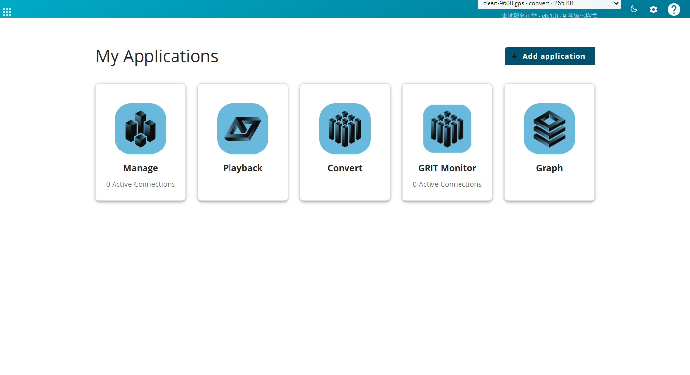
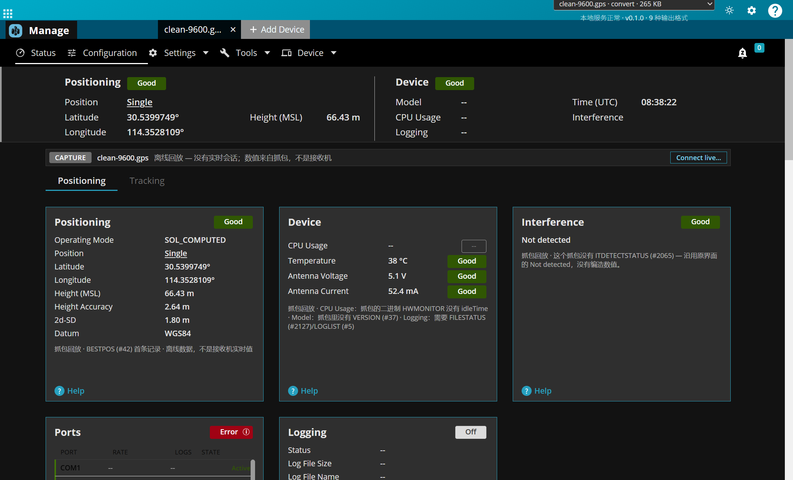
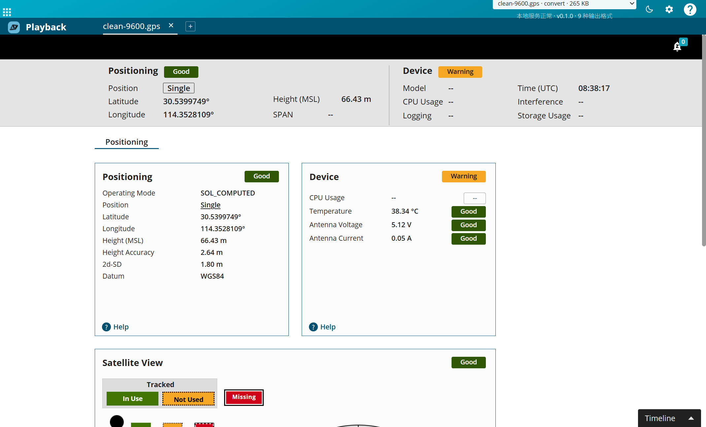
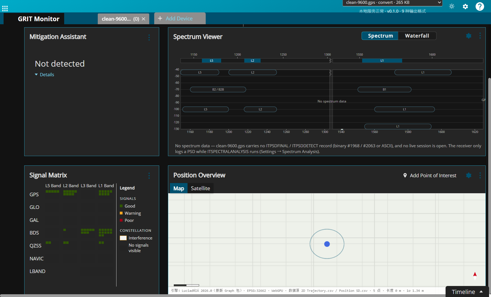
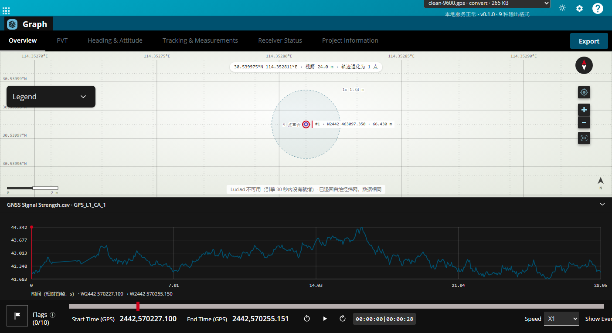
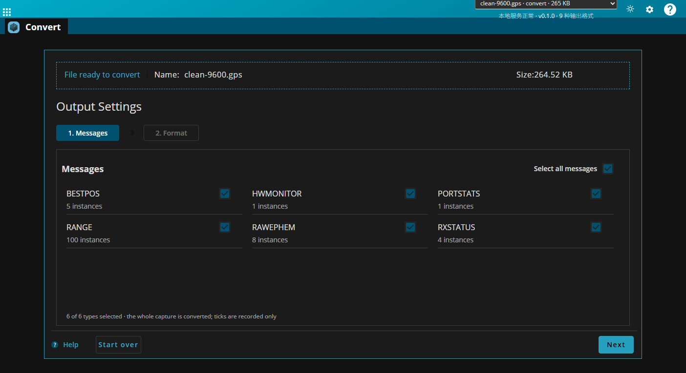
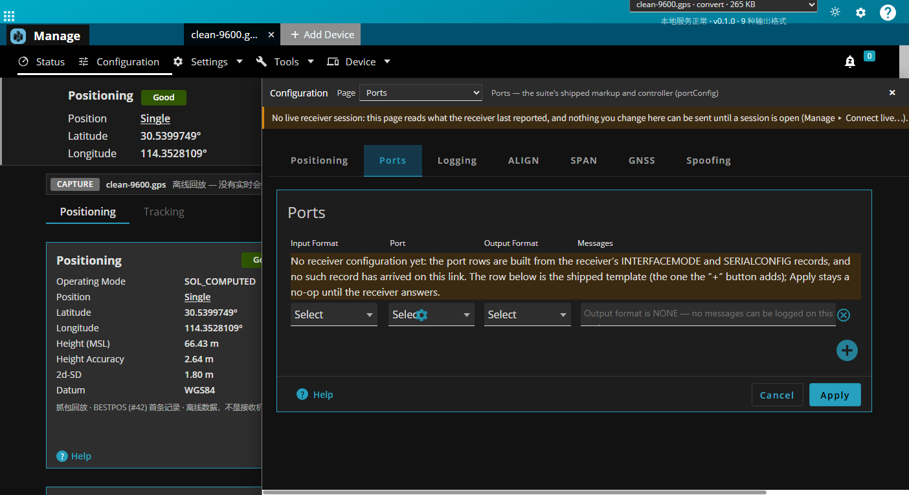

<a id="readme-top"></a>

<div align="center">
<br />
<h1>野外台站智能体 · OEM729 套件逆向重实现</h1>

[](https://github.com/yasunosubaru/field-station-agent/actions/workflows/ci.yml)
[](https://www.python.org/)
[](https://nodejs.org/)
[](#技术构成)
[](https://github.com/yasunosubaru/field-station-agent/releases/tag/v0.1.10)
[](#许可证)

<p>
  武汉大学地球与空间科学技术学院 · 2026 年大学生创新创业训练计划<br />
  一半让智能体接管野外台站，一半把接收机那套厂商软件拆开重写
</p>

<a href="#交付物">交付物</a>
·
<a href="#仓库地图">仓库地图</a>
·
<a href="#a-野外台站智能体">智能体</a>
·
<a href="#b-novatel-套件逆向与重实现">逆向重实现</a>
·
<a href="#质量门禁">质量门禁</a>
·
<a href="docs/README.md">文档索引</a>
·
<a href="../../issues/new">汇报缺陷</a>

</div>

> **桌面版 `All powered-FSA` 0.2.0（2026-11-04）**：一个 Windows 单文件 EXE，把
> 「Agent 工作台（类 Claude/ChatGPT）+ 专业面板（重实现的官方界面）」放进同一窗口，
> 底层同时具备**已逆向的 B 引擎**与**原版套件的 RPA 通道**。产物在
> `dist/AllPoweredFSA-0.2.0-win-x64/AllPoweredFSA.exe`（约 862 MiB，已内置 Node / Python /
> 样本 / 原版套件便携副本），使用说明见 [`docs/product/`](docs/product/README.md)。
> 未配模型 key 时以 `fake` 演示模式启动；设置里可切 OpenAI 兼容 API 或本机 Ollama。

> **v4 实施基线（2026-11-04 定稿，未实施）**：**Electron 壳**（OpenChamber 源码）+ **四个等价视角**
> （对话 / 编队 / 数据 / 套件）+ **两个互不依赖的 Agent 运行时**（OpenChamber+OpenCode 与
> Claude Agent SDK）+ **Bot 三组件**（DBOS 管时间 / LangGraph 管判断 / Letta 管记忆）+
> **数据双引擎**（一份 Parquet，DuckDB 默认、ClickHouse 随包）。**套件台重做**（不叠皮），
> **RPA 先收口**（校准工具 + DOM fixture 回放 + 通道升级 + 真机清单）。体积不再设上限。
> 决策：[ADR-008](docs/decisions/2026-11-04-界面底座与四台.md) ·
> [ADR-009](docs/decisions/2026-11-04-七引擎与工具面.md) ·
> [ADR-010](docs/decisions/2026-11-04-套件台重做与RPA收口.md)；
> 基线：[`docs/spec/2026-11-04-v4-实施基线.md`](docs/spec/2026-11-04-v4-实施基线.md)。
> 上面的 0.2.0 仍是**当前可用版本**。

<!-- 目录 -->
<details>
  <summary>目录</summary>
  <ol>
    <li><a href="#交付物">交付物</a></li>
    <li><a href="#界面速览">界面速览</a></li>
    <li><a href="#仓库地图">仓库地图</a></li>
    <li>
      <a href="#a-野外台站智能体">A · 野外台站智能体</a>
      <ul>
        <li><a href="#五类智能体">五类智能体</a></li>
        <li><a href="#系统怎么流转">系统怎么流转</a></li>
        <li><a href="#开始使用">开始使用</a></li>
        <li><a href="#数据现在是什么情况">数据现在是什么情况</a></li>
        <li><a href="#路线图">路线图</a></li>
      </ul>
    </li>
    <li>
      <a href="#b-novatel-套件逆向与重实现">B · NovAtel 套件逆向与重实现</a>
      <ul>
        <li><a href="#逆向产出了什么">逆向产出了什么</a></li>
        <li><a href="#gui-跑起来">GUI 跑起来</a></li>
        <li><a href="#保真度约定">保真度约定</a></li>
        <li><a href="#证据与不入库的东西">证据与不入库的东西</a></li>
        <li><a href="#覆盖边界">覆盖边界</a></li>
        <li><a href="#套件级RPA">套件级 RPA 的八条流程</a></li>
      </ul>
    </li>
    <li><a href="#质量门禁">质量门禁</a></li>
    <li><a href="#参与贡献">参与贡献</a></li>
    <li><a href="#许可证">许可证</a></li>
    <li><a href="#notices开源许可登记">Notices（开源许可登记）</a></li>
    <li><a href="#联系方式">联系方式</a></li>
    <li><a href="#致谢">致谢</a></li>
  </ol>
</details>

<!-- 交付物 -->
<a id="交付物"></a>
## 交付物

这个仓库装了两件互相独立、又互相供料的交付物。它们共用一套纪律：**每个对外数字都能由脚本回源**，每条结论都要有可复核的出处。

| | A. 野外台站智能体 | B. NovAtel 套件逆向与重实现 |
|---|---|---|
| 一句话 | 用五类智能体接管野外台站的监测、质控、研判、派单、归档 | 把厂商的 Electron 套件拆成文档 + 可运行重实现，再收成一个连 OEM729 的单文件 GUI |
| 代码 | Python 3.11，纯标准库 | 零依赖 TypeScript（Node ≥ 22.6 直接跑 `.ts`）+ WinForms/WebView2 外壳 |
| 原料 | 合成观测（M0/M1 阶段刻意不接真实数据） | 解包后的厂商二进制 + 真机抓取的 golden 文件 |
| 现在 | M0、M4 已完成；M3、M5 进行中 | 逆向文档 31 篇；重实现 1242 项测试；GUI 0.1.10 已发布；A−B 缺口已固化为 3 条工作流 |
| 入口 | [`src/`](src/) · [`docs/`](docs/) · [`harness/`](harness/) | [`逆向/`](逆向/README.md) · [`dist/`](dist/)（不入库） |

两只交付物的关系：台站里那套厂商软件只给二进制，行为却直接决定我们能不能自动读出接收机状态。
所以 B 是 A 的**取数前置**——先用 B 把接收机侧的数据通路打通，A 才有东西可判、可调度。

<a href="#readme-top">回到顶部</a>

<!-- 界面速览 -->
<a id="界面速览"></a>
## 界面速览

重实现的 GUI（`NovAtelReverse`，0.1.10）——上半为浅色默认，下半为暗色主题；暗色是可选开关，不跟随系统。

| | |
|---|---|
|  |  |
| 主界面「My Applications」：五个应用卡片、活动连接数 | Manage：状态瓦片 + 已建立的接收机会话 |
|  |  |
| Playback：工程回放、事件带、时间轴与地图联动 | GRIT Monitor：频谱、Signal Matrix、事件与终端 |
|  |  |
| Graph：工程编辑区（图表 / 地图 / 时间轴三块） | Convert：格式向导与转换结果 |
|  | |
| 配置抽屉里的 20 个配置页跟随外壳主题 | |

<a href="#readme-top">回到顶部</a>

<!-- 仓库地图 -->
<a id="仓库地图"></a>
## 仓库地图

| 路径 | 是什么 | 入口文档 |
|---|---|---|
| [`src/fieldstation/`](src/fieldstation/) | 交付物 A 的全部实现（智能体、摄取、质控、存储、看板） | [设计文档](docs/spec/2026-10-13-野外台站智能体基础设计.md) |
| [`tests/`](tests/) | 交付物 A 的回归：固定命令 `python -m unittest discover -s tests -t .` | [测试纪律](#参与贡献) |
| [`harness/`](harness/) | 发布门禁（五项）与确定性回放 | [selftest.py](harness/selftest.py) |
| [`tools/`](tools/) | 数字回源、脱敏守卫、软著源程序、图表生成等工具 | [工具表](docs/README.md#工具) |
| [`docs/`](docs/) | 设计文档、决策记录、运维手册、结题材料 | [文档索引](docs/README.md) |
| [`逆向/`](逆向/README.md) | 交付物 B：来源、解包、证据、分析、重实现、打包 | [逆向说明](逆向/README.md) |
| [`逆向/03_分析/`](逆向/03_分析/) | 逐子系统逆向文档，`文件:行号` 引用 + 可验收断言 | [约定](逆向/03_分析/_约定.md) |
| [`逆向/04_重实现/`](逆向/04_重实现/) | 可运行重实现：协议 / 会话 / 视图 / 应用 / 图表 / 回放 / 桌面 | [重实现说明](逆向/04_重实现/README.md) |
| [`workflows/`](workflows/README.md) | 原版 GUI 缺口的固定流程（YAML）与执行入口：状态机、锁、幂等、审计、人工闸门；应用内 **Workflows** 页签直接跑 | [流程目录](workflows/README.md) |
| [`逆向/05_打包/`](逆向/05_打包/) | WinForms + WebView2 外壳源码与打包说明 | [打包说明](逆向/05_打包/NovAtelReverseGui/README.md) |
| [`dist/`](dist/) | 发布产物（`.exe` 约 132 MB，**不入库**，见 Releases） | [Releases](../../releases) |
| [`logs/`](logs/) `data/` `config/` `figures/` | 回放日志、知识库与样本、配置样例、可入论文的图表 | [运维手册](docs/operations/dashboard.md) |
| `PROVENANCE.md` | 搬运件登记表：来源、commit、逐条改动 | [搬运纪律](#搬运件的纪律) |

两份新增材料：[`CHANGELOG.md`](CHANGELOG.md) 记版本，[`docs/README.md`](docs/README.md) 是全仓文档索引。

<a href="#readme-top">回到顶部</a>

<!-- A 野外台站智能体 -->
<a id="a-野外台站智能体"></a>
## A · 野外台站智能体

野外台站没人守着。供电、蓄电池、设备在线率、网络时延、探头温度分散在不同系统里，出问题要等
下次巡检才发现，时滞能拖到几周甚至几个月；观测数据也得靠有经验的人按时段一份份看。

这个交付物要做的事，是让一组智能体把这条链路接过去。系统形态是一个管理平台，不改动台站硬件，
通过互联网远程接入传感器、供电、网络与安防。

<a id="五类智能体"></a>
### 五类智能体

| 智能体 | 负责什么 |
|---|---|
| 设备状态监测 | 供电、蓄电池、在线率、网络时延、探头温度的统一观测面 |
| 数据质量校验 | 周跳、量级越限、多传感器交叉不一致，逐条判定可用性 |
| 异常故障研判 | 分清设备故障和环境真实变化，给成因排序和置信度 |
| 运维任务调度 | 派单、定优先级和时限，超时升级 |
| 数据管理归档 | 入库、版本管理、预处理、元数据登记 |

**规则裁决，模型归因。** 低置信度和高风险判断一律落到人工审批门，不让模型自己下结论。
一次错误的停机建议可能造成不可逆的数据损失，所以「不动」必须始终是个选项。

<a id="系统怎么流转"></a>
### 系统怎么流转

```
        台站现场（传感器 / 供电 / 网络 / 安防）
                            │
                            ▼
        ┌───────────────────────────────────────────┐
        │  摄取层  reader → rinex2 / rinex3 /        │
        │           hatanaka（CRINEX）               │
        └───────────────────────────────────────────┘
                            │
                            ▼
                    Observation / EpochPair
                            │
        ┌───────────────────┼───────────────────┐
        ▼                   ▼                   ▼
   ① 设备状态监测      ② 数据质量校验       ⑤ 数据管理归档
   统一观测面          可用性逐条判定        入库 / 版本 / 元数据
        │                   │                   ▲
        │                   │ 可用               │
        │                   ▼                   │
        │            ③ 异常故障研判              │
        │            成因排序 + 置信度            │
        │                   │                   │
        └─── 高置信度 ──────┼── 低置信度 ──┐     │
                            ▼             ▼     │
                     ④ 运维任务调度   人工审批门 │
                     派单 / 升级 / 时限     │     │
                            │             └─────┘ 批准后放行
                            └─────────────────────┘
                                          │
                                          ▼
                                告警看板（平台层）
```

<a id="开始使用"></a>
### 开始使用

前置只需要 Python 3.11 或更高版本与 git。**无第三方依赖**，不需要虚拟环境之外的任何安装。
代码用 `src` 布局，所以 `PYTHONPATH` 要显式指向 `src/`，否则 import 不到包。

```powershell
git clone https://github.com/yasunosubaru/field-station-agent.git
cd field-station-agent

# 1. 全部测试（skip 必须为零）
$env:PYTHONPATH="src"; python -m unittest discover -s tests -t .

# 2. 五项发布门禁
$env:PYTHONPATH="src"; python harness/selftest.py

# 3. 文档数字回源核对
python tools/audit_claims.py

# 4. 脱敏守卫
python tools/check_desensitization.py
```

第二步里的 skip 必须为零。`unittest` 不把 skip 当失败，静默跳过会让门禁看起来是绿的——
这条教训写在 [`.gitignore`](.gitignore) 顶部。

纪律命令有统一入口，只转发、不重实现，避免两套逻辑各自漂移：

```powershell
$env:PYTHONPATH="src"; python -m fieldstation.cli --help
```

| 命令 | 作用 |
|---|---|
| `selftest` | 五项一致性硬门禁，任一 FAIL 即非零退出 |
| `replay` | 确定性回放评测，可离线、不联网 |
| `audit` | 文档数字逐条回源核对 |
| `datadict` | 数据字典完整性门禁（M1 交付物，草稿态不算失败） |
| `sync` | 重新生成本文件的代码量区块 |
| `figures` | 生成论文可用的图表 |

固定测试命令不走这个入口，直接跑。它本身就是被转发的门禁之一。

M6 无人值守前置（不依赖真实样本，合成/演示口径已标注）：

```powershell
$env:PYTHONPATH="src"
python harness/heartbeat_replay.py            # 设备心跳三态（合成序列）
python harness/station_loop.py                # 调度：到点 / 错过 / 超时
python harness/heartbeat_replay.py --notify   # Webhook 默认 dry-run，不发请求
```

<a id="数据现在是什么情况"></a>
### 数据现在是什么情况

`data/` 目录没有真实台站数据，当前所有观测都来自 [`src/fieldstation/synthetic.py`](src/fieldstation/synthetic.py)，
固定种子生成，同一次输入跑两遍字节一致。M0 阶段刻意不接真实数据、不调真实模型：
先把评测底座做实，再接就有东西可以对。

<a id="路线图"></a>
### 路线图

阶段顺序：骨架 → 旧代码整合 → 框架 → 真实数据。评测底座在接真数据之前先做实。

- [x] **M0** 仓库骨架、旧代码整合、运行时最小核、评测底座
- [ ] **M1** 需求调研与接口梳理
- [ ] **M2** 真实数据接入层
- [ ] **M3** 数据质量校验智能体（进行中：M3-0…M3-3 已完成，M3-4 待标注样本）
- [x] **M4** 研判、调度、归档智能体与知识库（M4-0…M4-4 已完成）
- [ ] **M5** 集成联调与告警看板（M5-1…M5-4 已落地；真实样本相关验收待 #28/#33）
- [ ] **M6** 试运行与指标评估（无人值守前置 M6-4/M6-5/M6-6 已落地；真实试运行待样本）
- [ ] **M7** 成果整理与结题验收

[开放议题](../../issues) 里能看到全部提案和已知问题。逐阶段决策见
[`docs/superpowers/`](docs/superpowers/) 与 [`docs/decisions/`](docs/decisions/)。

<a href="#readme-top">回到顶部</a>

<!-- B 逆向重实现 -->
<a id="b-novatel-套件逆向与重实现"></a>
## B · NovAtel 套件逆向与重实现

台站里那套 **NovAtel Application Suite 2.11.0**（Manage / Playback / Convert / GRIT Monitor / Graph）
是接收机侧的官方配套软件。它只给二进制、没有源码，行为却直接决定我们能不能自动读出接收机状态、
能不能把日志转成可用格式。所以 [`逆向/`](逆向/README.md) 把它整个拆开，做成「文档 + 可运行重实现」
两件东西，全部以 `文件:行号` 为据。

<a id="逆向产出了什么"></a>
### 逆向产出了什么

| 项 | 现状 |
|---|---|
| 分析文档 | [`逆向/03_分析/`](逆向/03_分析/) 下 31 篇、约 16 700 行，**R1–R101** 条可验收断言（协议 / 解析 / Manage / 配置 / Convert / Playback / GRIT / Graph / Edie / 安装更新） |
| 重实现 | 零依赖 TypeScript，8 个包（协议 / 会话 / 视图 / 应用 / 图表 / 回放 / CLI / 桌面），**1242 项测试**（其中 1 项心跳用例对时序敏感，隔离运行必过） |
| 协议层 | CRC32（对过 OEM7 手册向量）、SBF 长/短头、成帧、ASCII/二进制命令、123 条消息 879 个字段、31 条重复块布局 |
| 会话层 | TCP / UDP / 串口、心跳、日志订阅，回环端到端 |
| 应用层 | Convert 9 种格式、Graph 13 类图表与 8 页 PDF、GRIT 频谱与 Signal Matrix、Playback 回放与事件带、Manage 19 个配置页与 11 个状态瓦片 |
| 交付形态 | `NovAtelReverse.exe` 单文件 GUI（WinForms + WebView2 外壳内嵌 Node 与重实现），见 [Releases](../../releases) |
| 认证证据 | REA 对 166 个 JS 文件的静态分析与可读摘要（`逆向/02_证据/`，163 MB，不入库） |

<a id="gui-跑起来"></a>
### GUI 跑起来

拿到 [`v0.1.10`](https://github.com/yasunosubaru/field-station-agent/releases/tag/v0.1.10) 里的
`NovAtelReverse.exe` 双击即可：单文件、不需要装 Node.js，首次启动解压到
`%LOCALAPPDATA%\NovAtelReverse\app-0.1.10.0`，之后直接开 1440×900 主窗口。
环境要求 Windows 10/11 x64 与 WebView2 Runtime（一般随 Edge 已装）。

从源码跑（无 npm 依赖、无需编译）：

```powershell
cd 逆向/04_重实现
node --test --test-force-exit "packages/*/test/*.test.ts"   # 1242 项
node packages/cli/src/probe.ts --list BESTPOS                # 查字段
node packages/app/src/server.ts --port 4711                  # 无外壳，直接开网页版
```

重新打包成单文件 exe 的配方在[打包说明](逆向/05_打包/NovAtelReverseGui/README.md)。

<a id="保真度约定"></a>
### 保真度约定

原实现有一批确凿缺陷（见 [`逆向/03_分析/00A_总体架构.md`](逆向/03_分析/00A_总体架构.md) 第 8 节）。
重实现的处理原则是三条：

1. **默认镜像**——默认行为与 2.11.0 一致，包括看起来是 bug 的地方；
2. **可观测**——原实现静默丢弃的字节、静默忽略的 CRC 不匹配，这里通过 `onDrop` / `crcOk` 暴露出来，但不改变消费决策；
3. **修正放开关后**——例如 `crcMode: 'validate'`、`gpsToUtcDate()`，要显式打开才生效。

数据目录（879 个字段偏移等）全部由脚本从应用自身的数据表导出，不是手抄，并有单测钉住。

<a id="证据与不入库的东西"></a>
### 证据与不入库的东西

| 目录 | 处理 | 原因 |
|---|---|---|
| `逆向/01_解包/` | 不入库（260 MB） | 厂商二进制与其解包产物；用 [`tools/asar_extract.js`](逆向/tools/asar_extract.js) 从本机安装目录重建 |
| `逆向/02_证据/` | 不入库（163 MB） | REA 分析产物，单文件超 GitHub 100 MB 硬限 |
| `逆向/00_来源/手册文本/` | 不入库 | 厂商手册的文本提取，原文在本地 `NovAtel/00_手册/` |
| `逆向/00_来源/samples/` | **入库**（golden 基准） | 厂商软件与真机自己写出来的文件，逐字节比对的基准；里面的本机路径属证据本体，脱敏守卫对它们单列豁免（见 [KI-12](docs/known-issues.md)） |
| `dist/`、`node_modules/`、`*.local.json` | 不入库 | 打包产物与本地凭据，见 [`.gitignore`](.gitignore) |

<a id="覆盖边界"></a>
### 覆盖边界

| 边界 | 说明 |
|---|---|
| OEM729 / OEM7 路径 | 一比一对齐，含与真机对接的 `probe.ts`、串口与 TCP 连接流程 |
| Longhorn（PIM222A） | 只到结构与文档，需要真机才能推进 |
| 固件 Update | 只读：没有可牺牲的单元，写路径未开放；Factory Reset 需人工确认 |
| 硬件与授权类 | SPAN/IMU、RTK fixed、双天线 ALIGN、Wi-Fi AP、LUA/API、内置存储、Galileo/GLONASS/NavIC/SBAS、HDR 与带通滤波、PIM/G-III/Longhorn 不在实现范围 |
| 地图底图 | Google 瓦片在当前网络不可达，GRIT 与 PDF 第二页改用 Esri World Imagery |
| 套件级 RPA | 不再是「不实现」：见下方[套件级 RPA 的八条流程](#套件级RPA)。八条已推到硬件边界，其中 3 条待真机 |

<!-- 套件级RPA -->
<a id="套件级RPA"></a>
### 套件级 RPA 的八条流程

`覆盖边界` 里原先写作「不实现」的那几条，现在的口径是**先收口**：代码已经推到硬件边界，
设备到位后每条流程只剩「通过 / 不通过」两个答案。状态分三档——`已自动`（无人值守跑完，
只在不可逆动作前停一次闸门）、`assisted`（自动走到写清楚的人工点，人做完后自动接着验证）、
`blocked: hardware`（代码到硬件边界为止，真机到位后照清单一次验完）。

| 流程 | 状态 | 为什么 |
|---|---|---|
| `gui.suite.autoupdate` | 已自动 | 条件等待弹窗文本，末尾 `Close` 收尾；2026-11-04 实跑 14~15 次轮询、4.4~4.6 s 后成功 |
| `gui.graph.export` | 已自动 | 走 `/api/graph/*`，不碰 Electron |
| `gui.device.add` | **blocked: hardware** | 前 8 步到 `approve_add` 闸门已通；「添加后设备卡出现」要真端口 |
| `gui.app.install` | assisted | 「Import from your computer」是原生 Open 对话框，CDP 点不到；主路径改走文件层 |
| `gui.app.update` | assisted | 本机没有可更新的应用；更新源是 AWS，要装一个旧版造场景 |
| `gui.device.update` | **blocked: hardware** | 到 `approve_apply` 之前全部自动；刷写与「回来」要设备 |
| `gui.graph.newproject`（文件 `gui.graph.new-project.yaml`） | 已自动 | Graph 带 `--remote-debugging-port=9224` 启动后 CDP 可用；驱动默认连 9223，跑 `plot` 前要指到 9224。`Select Folder` 与 Receiver Data 的 `Open` 两个原生对话框仍由人工 |
| `script.device.restart` | **blocked: hardware** | 命令通道已通；「重启后真的回来了」要设备 |

八条里 **3 条被硬件卡住**——`gui.device.add`、`gui.device.update`、`script.device.restart`
都要接一台真的接收机（本机 `/api/ports` 目前只有蓝牙串口）。它们不是没做完，是边界在这里：
点击路径、闸门、截图与失败分类都已验到硬件边界之前。

每条怎么跑、看什么、证据存哪，见 [`docs/operations/rpa-checklist.md`](docs/operations/rpa-checklist.md)（真机清单）；
三档状态的定义与逐条补完结论，见 [`docs/operations/rpa-completion.md`](docs/operations/rpa-completion.md)。

<a href="#readme-top">回到顶部</a>

<!-- 质量门禁 -->
<a id="质量门禁"></a>
## 质量门禁

两条流水线，一条在 CI，一条在本地跑。CI 只保留一条 workflow，其逐类取舍写在
[`ci.yml`](.github/workflows/ci.yml) 顶部。

| 门禁 | 命令 | 钉住什么 |
|---|---|---|
| 测试 | `python -m unittest discover -s tests -t .` | 交付物 A 全绿，且 skip 为零 |
| 五项自检 | `python harness/selftest.py` | 测试全绿 / 无源项目包名残留 / PROVENANCE 与 `src/` 双向一致 / 同 seed 可复现 / README 数字回源 |
| 数字回源 | `python tools/audit_claims.py` | README 里每个对外数字等于仓库实际状态 |
| 脱敏守卫 | `python tools/check_desensitization.py` | 本机路径、邮箱、手机号、学号、私钥、token 不进公开仓库（绊线，不是证明） |
| 重实现测试 | `node --test --test-force-exit "packages/*/test/*.test.ts"` | 交付物 B 的协议、会话、应用、图表、回放 |
| 覆盖矩阵 | `python tools/gui_coverage.py --check` | A（原版 GUI）× B（重实现）逐项映射与源码一致，A 无漏项、引用无失效 |

<a id="参与贡献"></a>
## 参与贡献

有想法就提 [issue](../../issues/new)，也可以 fork 后直接发 PR。团队成员在这个仓库里有写权限，
工作流和外部贡献者略有不同。第一次接触这个仓库的，先看
[新手上手：把代码跑起来](docs/team/新手上手与本地运行.md)：

1. 建自己的前缀分支，不直接推 `main`
2. 提交，且逐个列路径（不要 `git add -A`）
3. 推送分支
4. 发 PR，`main` 需要一次审批
   ```sh
   git checkout -b sch/your-task
   git commit -m 'feat: 做了什么'
   git push origin sch/your-task
   ```
5. 等审批合入

<a id="搬运件的纪律"></a>
### 搬运件的纪律

[`PROVENANCE.md`](PROVENANCE.md) 表里的文件来自一个历史项目，逐字搬运，登记了源路径、commit
和逐条改动说明。它们一律只读。确需改动时：

1. 先立 issue 说清楚动机
2. 先写一条让测试变红的回归
3. PR 里更新 PROVENANCE 的改动列
4. 证明既有真实样本的行为逐字节没变

少一步都不合。这些文件是项目唯一的历史证据，改坏了查不回来。

### 提交时的自检

```powershell
$env:PYTHONPATH="src"; python -m unittest discover -s tests -t .
$env:PYTHONPATH="src"; python harness/selftest.py
python tools/audit_claims.py
python tools/check_desensitization.py
```

**写本文档的人注意**：`tools/audit_claims.py` 会把文档里「一个词、冒号、紧跟一个数字」这种形状的
句子记为无法回源，而无法回源的条目会让它返回退出码 1。所以本文档里的数字一律放进表格，表格里的
竖线会被它的正则排除。正文里别出现那个形状，门禁会红。代码量区块由 `tools/sync_code_counts.py`
生成，别手改。

<!-- CODE_COUNTS:BEGIN -->
## 代码量（机维护，请勿手改）

- 入库 Python 文件数：**208** 个
- 入库 Python 行数：**53,985** 行
- 入库测试文件数：**116** 个

> 口径：`git ls-files` 下 `src/` 与 `tests/` 内的 `.py` 文件；未入库文件不计。
> 本块由 `tools/sync_code_counts.py` 生成，由 `tools/audit_claims.py` 回源核对，
> 共用同一口径。
<!-- CODE_COUNTS:END -->

<p align="right">(<a href="#readme-top">回到顶部</a>)</p>

<!-- 技术构成 -->
<a id="技术构成"></a>
## 技术构成

| 组件 | 用在哪 | 状态 |
|---|---|---|
| [Python 3.11](https://www.python.org/) | 交付物 A 的全部代码 | 唯一运行时，无第三方依赖 |
| [LangGraph](docs/decisions/2026-10-14-智能体运行时选型.md) | 交付物 A 的智能体运行时 | [ADR-001](docs/decisions/2026-10-14-智能体运行时选型.md) 选定，尚未导入 |
| [MCP](docs/decisions/2026-10-14-智能体运行时选型.md) | 工具接口协议 | 同上 |
| Node 22.6+ | 交付物 B 的重实现（原生类型擦除直接跑 `.ts`） | 唯一构建期依赖为零 |
| WinForms + WebView2 | 交付物 B 的 GUI 外壳 | 打包成单文件 exe |
| `serialport`（可选） | 重实现的串口传输 | 只有 `--serial` 路径才加载 |

<a href="#readme-top">回到顶部</a>

<!-- 许可证 -->
<a id="许可证"></a>
## 许可证

本仓库采用 [MIT](LICENSE)，版权归项目组所有。为什么不选 Apache-2.0 或 BSD-3-Clause，
对比写在 [ADR-002](docs/decisions/2026-10-15-许可证选择.md)。

一句话版本：宽松、无附加义务、不限制团队后续把同一套代码用于论文、专利或软著。

有一个例外要说在前面：`PROVENANCE.md` 表内 17 个搬运件来自一个校内结项项目，
上游未见许可声明。MIT 覆盖的是本仓库自有代码，不覆盖那 17 件的上游授权，
引用或复用那一部分前请自行确认上游。逐项登记见下一节。

<p align="right">(<a href="#readme-top">回到顶部</a>)</p>

<!-- 开源许可登记 -->
<a id="notices开源许可登记"></a>
## Notices（开源许可登记）

| 项目 | 用在本仓库的哪里 | 许可 |
|---|---|---|
| Python | 全部代码的运行时 | PSF-2.0 |
| matplotlib | `tools/make_cli_figures.py` 的 PNG 出图，可选依赖；缺它时该工具以退出码 2 优雅中止，测试与五项门禁不受影响（登记于 `docs/known-issues.md` KI-09） | BSD-3-Clause（Matplotlib License） |
| [Best-README-Template](https://github.com/othneildrew/Best-README-Template) | 本页的页面结构 | MIT |
| [shields.io](https://github.com/badges/shields) | 本页顶部的状态徽章 | CC0-1.0 |
| [LangGraph](https://github.com/langchain-ai/langgraph) | ADR-001 选定的智能体运行时，尚未导入，M3 起引入 | MIT |
| [Langfuse](https://github.com/langfuse/langfuse) | ADR-001 选定的 trace 格式参照，尚未导入；参照的是其 schema，不复用其代码 | MIT（核心仓库） |
| NovAtel Application Suite 2.11.0（厂商软件） | `逆向/` 下**仅**自产的分析文档与重实现代码；解包产物、原生模块、安装包与手册原文不入库（见 [`逆向/.gitignore`](逆向/.gitignore)） | 厂商专有。重实现是行为复刻，不复用其代码；解包证据需从本机安装目录重建 |

本仓库的上游来源不是第三方开源项目，单独说明：

| 来源 | 涉及范围 | 状态 |
|---|---|---|
| GNSS接收机TEC反演（校内结项项目） | `PROVENANCE.md` 表内 17 个文件 | 未见许可声明。MIT 不覆盖这部分的上游授权，复用前请自行确认 |

徽章与许可标志只是速记，以本表为准。

<p align="right">(<a href="#readme-top">回到顶部</a>)</p>

<!-- 联系方式 -->
<a id="联系方式"></a>
## 联系方式

个人姓名、学号、电话、邮箱不进这个仓库，仓库已转为私有也一样。

CI 里有一道脱敏守卫（`tools/check_desensitization.py`）：扫入库文本里的用户目录路径、手机号、邮箱、
13 位学号形状与私钥/token；姓名等无法公开列词的类别靠本机 `tools/desensitization.local.txt`（gitignored）。
它是**绊线不是证明**——M0 的教训是正则扫描器给过假的「0 命中」，最终靠字面值比对才验干净。

协作走这两个地方就行：

* 缺陷和需求：[开放议题](../../issues)
* 任务看板：[Project 看板](https://github.com/users/yasunosubaru/projects/1/views/1)

<p align="right">(<a href="#readme-top">回到顶部</a>)</p>

<!-- 致谢 -->
<a id="致谢"></a>
## 致谢

* [GNSS接收机TEC反演项目](PROVENANCE.md)：`src/fieldstation/` 里大半代码的来源，
  逐件登记在 PROVENANCE 中。没有它，这个仓库现在只是一份方案
* [Best-README-Template](https://github.com/othneildrew/Best-README-Template)：本页的结构
* [Signs of AI writing](https://en.wikipedia.org/wiki/Wikipedia:Signs_of_AI_writing)：本页的措辞参考
* [Img Shields](https://shields.io/) · [Choose an Open Source License](https://choosealicense.com/)

<p align="right">(<a href="#readme-top">回到顶部</a>)</p>
