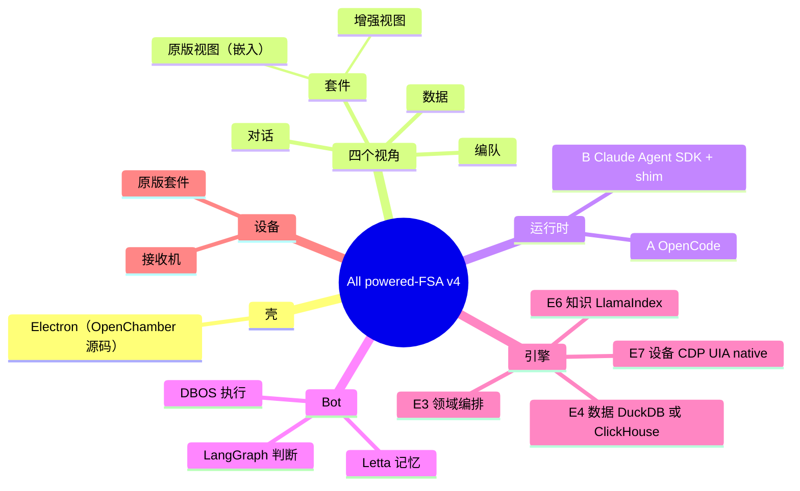
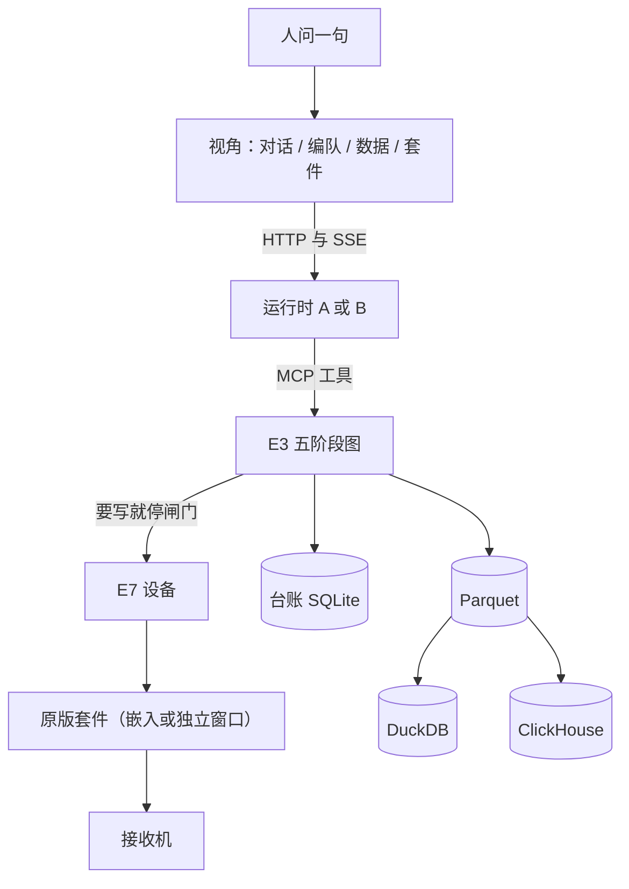

# 架构图（Obsidian Canvas）

当前定稿是 **v4**：Electron 壳 · 四个等价视角 · 双 Agent 运行时 · Bot 三组件 · 数据双引擎 · 原版套件嵌入。

## 怎么打开

| 方式 | 路径 |
|---|---|
| 仓库正本 | `docs/arch/架构总图.canvas`（纯 JSON，可 diff、可手改坐标） |
| Obsidian | 已在 vault `PC-File-Map` 里放了一份：`野外台站智能体-v2架构/架构总图.canvas`；也可「打开文件夹作为仓库」选本仓库根目录再点开 |
| 文本版 | 本文 §2 的 Mermaid（Obsidian 原生渲染） |

**颜色**：蓝＝壳，橙＝四个视角，绿＝运行时与引擎，紫＝存储。
**读法**：上边是人，下边是设备；只画了主链路，每个视角的数据来源写在自己卡里。

> 画布里的文字是**纯文本**（不用 Markdown 语法）。实测：带 `**加粗**`、反引号或嵌套引号的卡片会让
> Obsidian Canvas 整块渲染失败，所以这里刻意保持朴素——要排版好看，用本文的 Mermaid 或 `docs/spec/`。

## 1. 这张图回答什么

1. **四个视角是等价的**：能力不分区，共享同一会话池 / 任务表 / 工具 / trace，跨视角深链双向；
2. **Agent 有两个运行时**，A（OpenCode）与 B（Claude Agent SDK）互不依赖，任一缺失另一个照常；
3. **Bot 是三组件协作**：DBOS 管时间、LangGraph 管判断、Letta 管记忆，`run_link` 是唯一耦合点；
4. **数据是一份 Parquet、两个引擎**：DuckDB 默认、ClickHouse 随包，不可用自动回落并明示；
5. **套件台两个挡位**：增强视图（Manage / Workflows / Graph 重做）+ 原版视图（原版窗口直接嵌入）。

## 2. 从属关系（Mermaid）

## 3. 一次请求（Mermaid）

## 4. 与上一版的差别

| 上一版 | 这一版 |
|---|---|
| WinForms + WebView2 壳 | **Electron**（体积不再设限） |
| 套件台整页重做六个页签 | **增强视图 + 原版嵌入**，只重做三个高频页 |
| 数据默认 DuckDB、ClickHouse 可选 | **两套都随包**，设置里切 |
| 四台按"人"划分 | 四个**等价视角**，能力不分区 |

## 5. 未定

1. 套件台嵌入的 DPI / 焦点细节（W3 spike 出结论）；
2. Letta 能否单进程内嵌（W0 spike）；
3. ClickHouse 的方言适配范围（W8 用 20 条基准 SQL 卡）。
