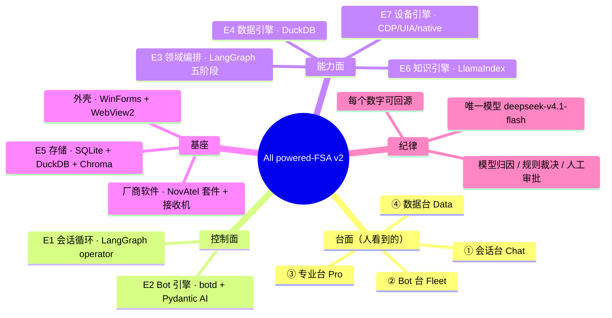
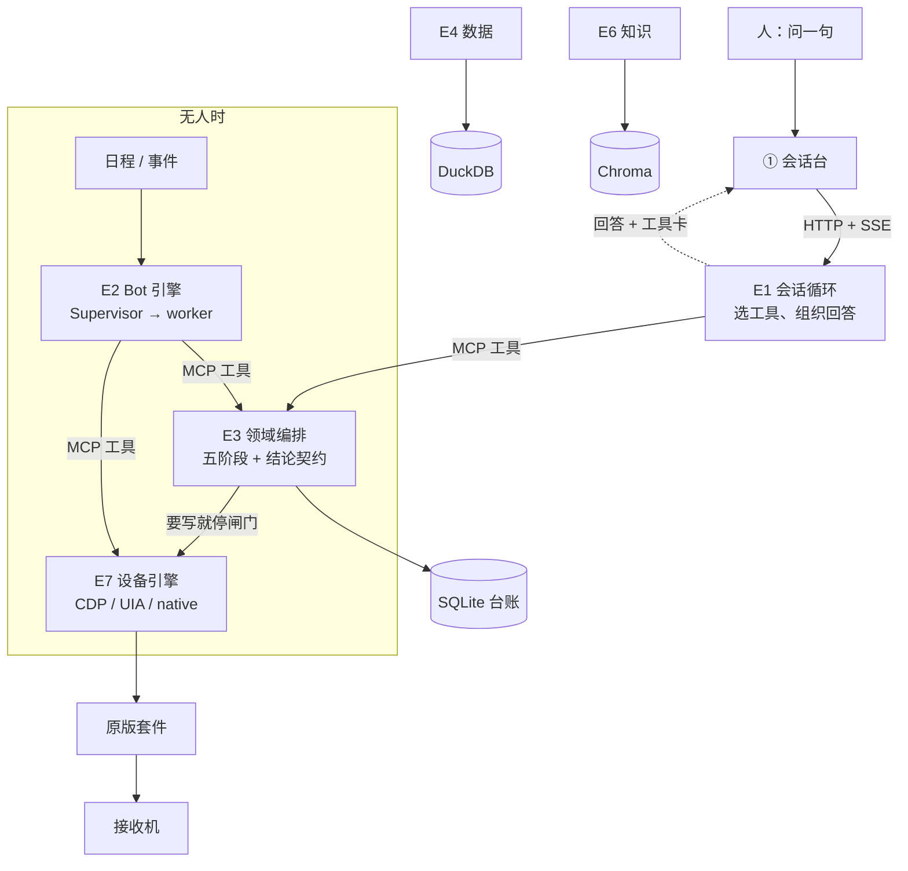

# v2 架构图（Obsidian Canvas）

这里是同一套架构的**三种画法**，按场合挑一个看：

| 文件 | 画法 | 什么时候看 |
|---|---|---|
| [`架构总图.canvas`](架构总图.canvas) | Obsidian Canvas，五层方块 + 主链路箭头 | 想一次看全、想拖动/批注 |
| 本文 §2 的 Mermaid | 思维导图（Obsidian 原生渲染） | 只想看从属关系 |
| 本文 §3 的 Mermaid | 流程图 | 只想看一次请求怎么走 |

## 1. 怎么打开

**正本在仓库里**（`docs/v2/架构总图.canvas`），Obsidian 只是画布：

- 已经放了一份副本到 vault：`PC-File-Map / 野外台站智能体-v2架构 / 架构总图.canvas`，
  打开 Obsidian 就能看到；
- 想直接用仓库那份：Obsidian →「打开文件夹作为仓库」→ 选本仓库根目录（或 `docs/v2`），
  再点开 `架构总图.canvas`；
- Canvas 是纯 JSON，可以 `git diff`、可以手改坐标，不存在"图片对不上代码"的问题。

**颜色约定**：橙＝人要看的四个台，绿＝我们写的引擎，紫＝存储；
右侧紫色那一栏是**还没拍板**的事。

## 2. 从属关系（Mermaid 思维导图）

## 3. 一次请求（Mermaid 流程图）

**人在问** 和 **bot 在守** 走的是同一批工具、同一条 trace，差别只在「谁发起」。

## 4. 界面底座：三个候选，还没拍板

上一版我直接写了「底座用 Open WebUI」，那是越权替你做了决定。这里把三个候选摆开，
**你挑一个**，我再按它落成实施计划。

| 判据 | A · Open WebUI | B · LibreChat / LobeHub | C · 自己写（沿用 0.2.0） |
|---|---|---|---|
| 四个台要写多少 | 三个台开箱即用，只补 Bot/数据两个视图 | 会话与 Agent 开箱，知识库要补 | 四个台全自己写 |
| 后端栈 | Python/FastAPI —— **和引擎同栈** | Node + Mongo/Postgres | Node/Python 皆可 |
| 部署复杂度 | 单进程 + SQLite | 多一个数据库服务 | 最低（已有） |
| 体积（解压后） | +400–500 MB | +500 MB 起 | +0 |
| 界面完成度 | 好（务实、信息密度够） | 最好看 | 现在这套（你说不行） |
| 许可 | BSD-3 + 品牌条款（≤50 人可去标识，我们保留署名） | MIT / Apache 系 | 自有 |
| 风险 | 上游漂移、依赖重 | 数据库常驻、便携性差 | 加一个台就贵一分（当前痛点） |

**我的建议**：如果目标是"四个台都像样、并且后端不再造第二套"，选 **A**；
如果目标是"界面最好看、愿意多带一个 Postgres"，选 **B**；
如果体积和可控性优先、愿意继续投人力写界面，选 **C**＋只借组件库。

**不建议的**：把 A/B 的整包直接嵌进我们的壳再套一层（两套 UI、两套主题、两套权限），
那是把复杂度翻倍，不是"用成熟框架"。

## 5. 这一版和上一版的差别

| 上一版（树状图） | 这一版（Canvas） |
|---|---|
| 一棵从上到下的树，层级靠缩进表达 | 五条横带，层级靠**空间**表达，一眼看出"这层坏了影响谁" |
| 所有细节都堆在节点里 | 卡片只留「谁用 / 做什么 / 数据从哪来 / 验收」 |
| 箭头画满 | 只画主链路，其余写进卡片，避免线缠在一起 |
| 预设了 Open WebUI | 底座留成三选一，等你拍板 |

## 6. 还没定的（都在这份图里标出来了）

1. **界面底座**：A / B / C 三选一（§4）；
2. **E5 存储的实际形态**：SQLite 够不够、DuckDB 什么时候上（W0 实测后定）；
3. **bot 的沙箱强度**：受限目录先够用，容器化留给以后；
4. **专业台的换肤**：`modern.css` 已落地，是否需要"一键回原版外观"的开关由你定。
